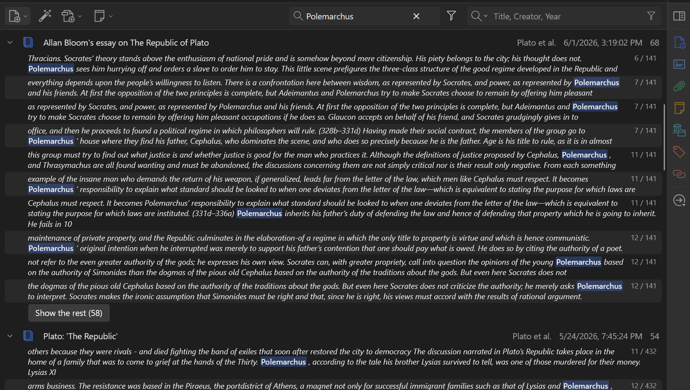

# Preview Search Results

Zotero 8–10 add-on. It searches all the PDFs in the selected collection and lists each search result with a short preview.



## Features

- Search box beside Zotero’s Search box. A search runs only on Enter
- Scope is the selection at search time: one collection plus its subcollections, several collections together, or My Library for the whole library.
- Search result previews sit under the book title. Four lines, matched word marked.
- Click a preview to open that page. The mark is a temporary red underline, not a saved highlight. (beta)
- Advance Search Options: match case, whole word (default), starts with, or anywhere in a word. A quoted query is a phrase, for example `"urban planning"`. Accents are ignored unless match case is on.
- Books sort by hit count. The first 10 previews show; one click loads the rest for that book.

## Install

Download `preview-search-results.xpi` from the [v0.1.24 release](https://github.com/abdullahmushtaq19/zotero-preview-search-results/releases/tag/v0.1.24). In Zotero: **Tools → Add-ons → gear → Install Add-on From File…**, pick that file, restart if asked.

Zotero checks for a newer release on its own after that. Restart when it asks.

To build the same `.xpi` from this folder:

```powershell
python scripts/pack.py
```

That writes `build/preview-search-results.xpi`.

## Setup

Zotero has to finish full-text indexing on the PDFs first. Unindexed files do not appear.

Select a collection in the left pane, type in **Search this collection**, press Enter. Open the funnel if you need a different match rule. Click a preview to jump into the PDF.
